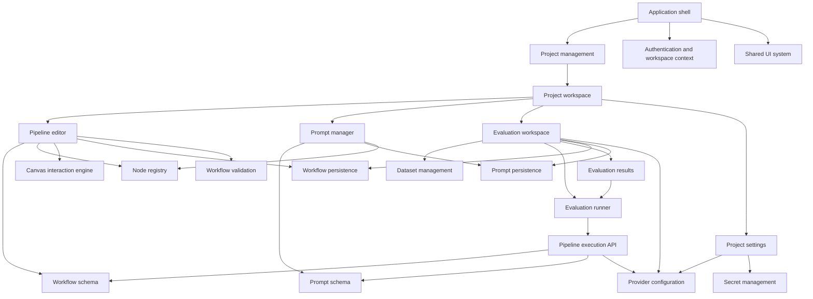
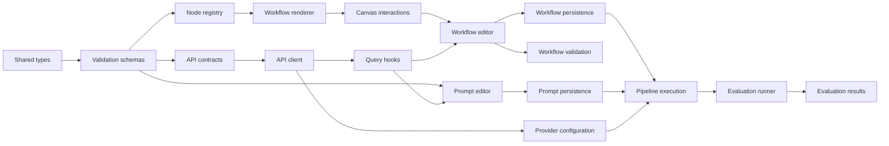
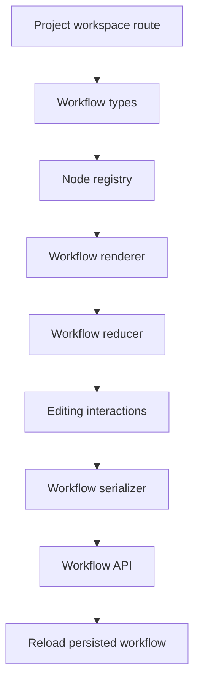
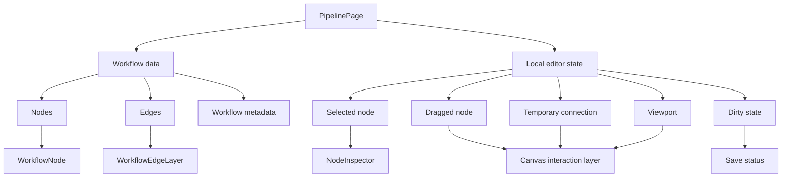
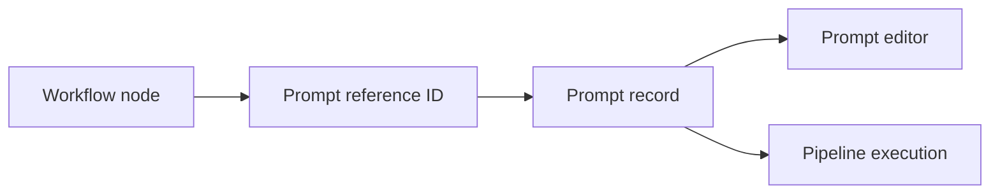
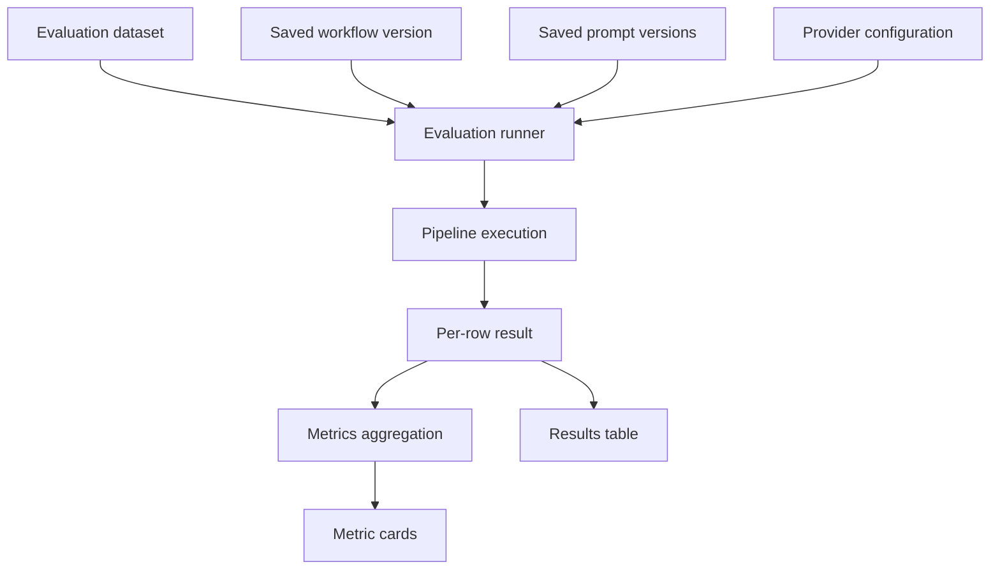

# BojAI Frontend Dependency Graph

This document defines the main frontend dependencies and the recommended implementation order for the BojAI healthcare chatbot and agent builder.

---

## 1. High-level product dependency graph



---

## 2. Detailed frontend dependency graph

```mermaid
graph TD
    App --> Router
    App --> Providers
    App --> SharedComponents

    Providers --> AuthProvider
    Providers --> ToastProvider
    Providers --> QueryProvider
    Providers --> WorkspaceProvider

    Router --> ProjectsPage
    Router --> ProjectWorkspacePage

    ProjectsPage --> ProjectListQuery
    ProjectsPage --> ProjectCard
    ProjectsPage --> CreateProjectMutation

    ProjectWorkspacePage --> ProjectQuery
    ProjectWorkspacePage --> ProjectNavigation
    ProjectWorkspacePage --> PipelinePage
    ProjectWorkspacePage --> PromptsPage
    ProjectWorkspacePage --> EvaluationPage
    ProjectWorkspacePage --> SettingsPage

    PipelinePage --> PipelineQuery
    PipelinePage --> PipelineStore
    PipelinePage --> AgentPalette
    PipelinePage --> WorkflowCanvas
    PipelinePage --> NodeInspector
    PipelinePage --> PipelineToolbar

    AgentPalette --> NodeRegistry
    WorkflowCanvas --> NodeRegistry
    WorkflowCanvas --> WorkflowNode
    WorkflowCanvas --> WorkflowEdgeLayer
    WorkflowCanvas --> CanvasInteractionState

    WorkflowNode --> NodeDefinition
    WorkflowNode --> NodeConfiguration

    NodeInspector --> NodeDefinition
    NodeInspector --> PromptNavigation

    PipelineToolbar --> ValidatePipelineMutation
    PipelineToolbar --> SavePipelineMutation

    SavePipelineMutation --> WorkflowSerializer
    ValidatePipelineMutation --> WorkflowSchema

    PromptsPage --> PromptsQuery
    PromptsPage --> PromptEditor

    PromptEditor --> PromptSchema
    PromptEditor --> SavePromptMutation
    PromptEditor --> PromptVariableRegistry

    PromptNavigation --> PromptsPage

    EvaluationPage --> DatasetEditor
    EvaluationPage --> EvaluationRunner
    EvaluationPage --> EvaluationResults

    DatasetEditor --> CsvParser
    DatasetEditor --> DatasetSchema

    EvaluationRunner --> RunEvaluationMutation

    RunEvaluationMutation --> SavedPipeline
    RunEvaluationMutation --> SavedPrompts
    RunEvaluationMutation --> ProviderConfiguration

    EvaluationResults --> EvaluationRunQuery
    EvaluationResults --> EvaluationMetricCards
    EvaluationResults --> EvaluationResultsTable
    EvaluationResults --> ExportEvaluationAction

    SettingsPage --> ProjectDetailsForm
    SettingsPage --> ProviderConfigurationForm
    SettingsPage --> DangerZone

    ProviderConfigurationForm --> ProviderRegistry
    ProviderConfigurationForm --> TestConnectionMutation
    ProviderConfigurationForm --> SaveProviderMutation
```



---

## 3. Core implementation dependency chain

```text
1. Shared TypeScript types
   ↓
2. Workflow and node schemas
   ↓
3. API contract definitions
   ↓
4. API client layer
   ↓
5. Query and mutation hooks
   ↓
6. Project workspace shell
   ↓
7. Node registry
   ↓
8. Read-only workflow renderer
   ↓
9. Canvas interaction state
   ↓
10. Workflow editing
   ↓
11. Workflow save and validation
   ↓
12. Prompt editing and persistence
   ↓
13. Provider configuration
   ↓
14. Pipeline execution
   ↓
15. Evaluation runner
   ↓
16. Evaluation result rendering
```

Visual version:



---

## 4. Feature dependency matrix

| Feature | Depends on |
|---|---|
| Projects dashboard | Router, shared UI, project types, mock project data |
| Project workspace | Router, project query or mock data, navigation components |
| Pipeline palette | Node registry, node definitions |
| Read-only workflow canvas | Workflow types, node registry, SVG edge renderer |
| Node inspector | Selected-node state, node registry |
| Dragging nodes | Canvas state, workflow reducer |
| Connecting nodes | Port model, temporary edge state, workflow reducer |
| Saving workflow | Workflow serializer, validation schema, API client |
| Prompt editor | Prompt types, prompt schema, prompt variable registry |
| Provider settings | Provider registry, form components, secret-field handling |
| Manual evaluation dataset | Dataset schema, editable table components |
| CSV evaluation upload | File input, CSV parser, dataset validation |
| Running evaluations | Saved workflow, saved prompts, provider configuration |
| Evaluation results | Evaluation run API, metrics model, results table |
| Export results | Evaluation results, CSV serializer |

---

## 5. Recommended frontend build order

### Phase 1: Foundation

```text
Vite React TypeScript setup
React Router
Shared styles
Shared UI components
Domain types
Route placeholders
```

### Phase 2: Projects dashboard

```text
ProjectsPage
ProjectsHero
ProjectStatsGrid
ProjectGrid
ProjectCard
NewProjectCard
Static mock project data
```

### Phase 3: Project workspace shell

```text
ProjectWorkspacePage
AppHeader
Breadcrumbs
ProjectNavigation
Pipeline route
Prompts route
Evaluation route
Settings route
```

### Phase 4: Read-only pipeline

```text
PipelinePage
AgentPalette
WorkflowCanvas
WorkflowNode
WorkflowEdgeLayer
SafetyBarrierZone
NodeInspector
Mock workflow data
```

### Phase 5: Editable pipeline

```text
Workflow reducer
Node selection
Node dragging
Add node
Delete node
Create edge
Delete edge
Reset pipeline
Basic validation
```

### Phase 6: Prompt manager

```text
PromptSidebar
PromptEditorPanel
PromptVariableChip
Revert prompt
Save prompt locally
Mock prompt data
```

### Phase 7: Settings

```text
Project details form
Provider selector
AWS configuration
Anthropic configuration
OpenAI configuration
Test connection mock
Save settings locally
```

### Phase 8: Evaluation workspace

```text
Manual dataset editor
CSV uploader
Dataset validation
Run evaluation mock
Evaluation metric cards
Evaluation result table
Export CSV
```

### Phase 9: Backend integration

```text
API contracts
API client
Project endpoints
Workflow endpoints
Prompt endpoints
Settings endpoints
Evaluation endpoints
Replace mock data gradually
```

---

## 6. First functional vertical slice

The first full vertical slice should be:

```text
Open project
→ load workflow
→ add node
→ move node
→ connect nodes
→ select node
→ delete node
→ save workflow
→ refresh page
→ restore the same workflow
```

This slice depends on:



---

## 7. Pipeline state dependencies



---

## 8. Prompt and pipeline relationship

Prompts should not be embedded directly into canvas nodes.



Recommended relationship:

```ts
type WorkflowNode = {
  id: string;
  type: string;
  position: {
    x: number;
    y: number;
  };
  config: {
    promptId?: string;
    [key: string]: unknown;
  };
};
```

This allows prompt versioning without rewriting the workflow graph.

---

## 9. Evaluation dependencies



An evaluation run should reference immutable versions:

```text
evaluation run
├── dataset version
├── workflow version
├── prompt versions
├── model/provider configuration snapshot
└── result rows
```

---

## 10. State ownership rules

### Page-level state

Use page or feature-level state for:

```text
current project
loaded workflow
loaded prompts
loaded dataset
evaluation results
```

### Component-local state

Use component-local state for:

```text
open or closed dropdown
hover state
temporary input
selected tab inside one card
password visibility
```

### Reducer state

Use a reducer for pipeline editing:

```text
NODE_ADDED
NODE_MOVED
NODE_SELECTED
NODE_DELETED
EDGE_ADDED
EDGE_DELETED
WORKFLOW_RESET
WORKFLOW_LOADED
```

### Server-state library

Introduce a server-state library only when real APIs exist.

Possible future use:

```text
projects query
project query
workflow query
prompts query
evaluation run query
save mutations
```

---

## 11. Architectural rules

1. The static mock is a visual and behavioral reference, not production architecture.
2. Do not copy the entire mock into one React component.
3. Do not use direct DOM manipulation for application state.
4. The workflow must be represented as serializable data.
5. Nodes must be registered through a node registry.
6. Prompts must be stored separately from workflow nodes.
7. Evaluation runs must reference saved versions.
8. Backend execution must not be implemented inside frontend components.
9. Canvas interaction state should remain separate from persisted workflow state.
10. Build read-only rendering before drag-and-drop editing.
